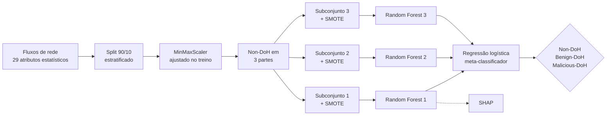
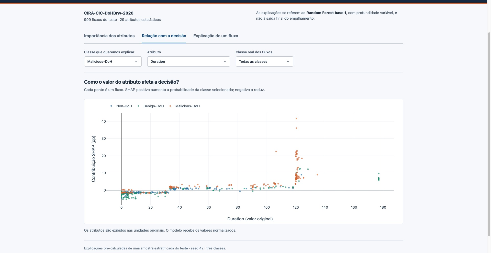
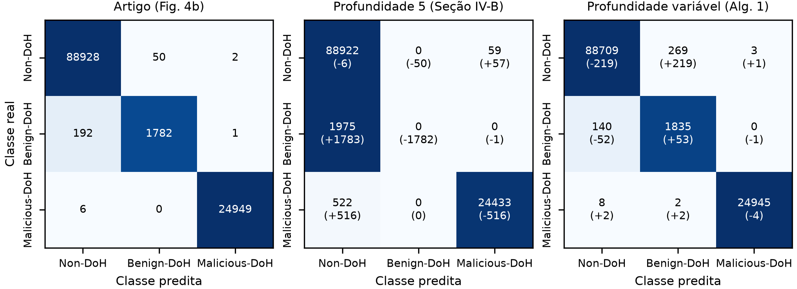
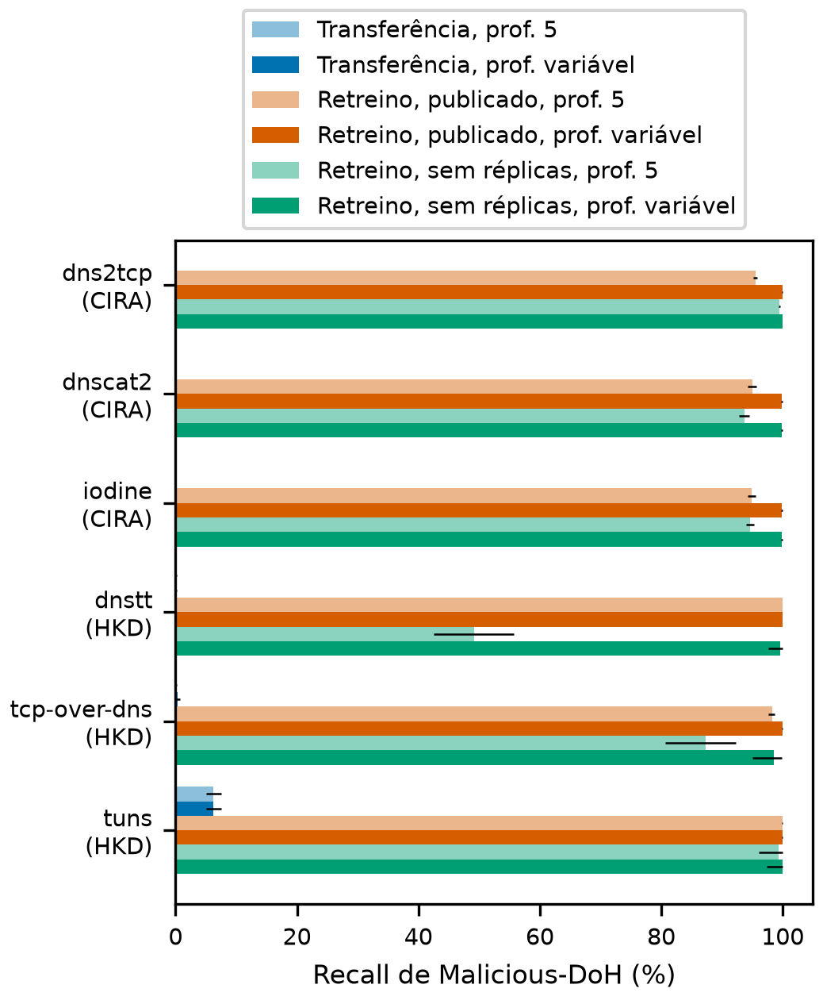

<div align="center">

# IDS explicável para ataques DNS over HTTPS

**Reprodução e avaliação em dois conjuntos de dados de um sistema de detecção de intrusão para túneis DNS sobre HTTPS.**

[](https://github.com/amandaarruda/Tecnicas_Ataque_Deteccao_Intrusao/actions/workflows/ci.yml)


</div>

Projeto da disciplina **CIN0114, Técnicas de Ataque e Detecção de Intrusão** (CIn/UFPE, 2026.2), do Prof. Paulo Freitas de Araujo Filho. O artigo reproduzido:

> T. Zebin, S. Rezvy and Y. Luo, "An Explainable AI-Based Intrusion Detection System for DNS Over HTTPS (DoH) Attacks," *IEEE Trans. Inf. Forensics Security*, vol. 17, pp. 2339-2349, 2022, doi: [10.1109/TIFS.2022.3183390](https://doi.org/10.1109/TIFS.2022.3183390).

Reimplementamos o sistema a partir do texto do artigo, porque o repositório dos autores não contém o modelo, medimos a variância em dez seeds e encontramos um resultado compatível com um detector que aprendeu um artefato da captura dos dados: treinado no conjunto original, ele deixa passar 98% dos túneis de três ferramentas que não viu.

## O que foi feito

| Objetivo | Entrega | Onde ver |
| --- | --- | --- |
| **1. Reproduzir os experimentos do artigo** | Implementação e comparação dos resultados: Tabela I, Fig. 2, Fig. 4, Tabela II, Figs. 5 a 8, Seção VI-D e Fig. 9 | [`results/e0`](project/results/e0/dados/RESUMO.md) a [`e7`](project/results/e7/RESUMO.md) |
| **2. Outro conjunto de dados** | Tudo refeito no combinado CIRA + HKD sem réplicas; transferência do modelo original para o DoH-Tunnel-Traffic-HKD ao lado | [`results/e6`](project/results/e6/RESUMO.md) |
| **Experimentos complementares** | Random Forest único com peso de classe, comparações em dez seeds, robustez e custo de inferência | [`results/e8`](project/results/e8/corrigida/RESUMO.md) |
| **Painel interativo** | Exploração dos atributos e das explicações SHAP de fluxos reais do teste | [Versão web e publicação](painel/README.md) |

## O sistema do artigo



## Painel interativo

O painel permite escolher uma classe de tráfego, descobrir quais atributos mais pesam na classificação e entender a contribuição de cada atributo na decisão de um fluxo. Também é possível explorar a relação entre um atributo, como a duração, e seu valor SHAP, além de baixar a explicação de um fluxo em CSV.

A **versão web está preparada para GitHub Pages** e usa explicações reais de **999 fluxos do teste do CIRA**, com 333 exemplos por classe. Os valores SHAP e as probabilidades já foram calculados; a navegação funciona no navegador, sem executar o treinamento online. As explicações se referem ao primeiro Random Forest base, na leitura de profundidade variável.

<p align="center">
  
</p>

Para abrir a versão web localmente, execute na raiz do repositório:

```bash
python3 -m http.server 8080 --directory painel
```

Depois acesse http://127.0.0.1:8080. As [instruções de publicação](painel/README.md#publicar-no-novo-repositório) explicam como disponibilizá-la no novo repositório público. O [painel Python completo](project/scripts/painel_xai.py) também pode ser executado com os dados preparados, seguindo o [guia técnico](project/README.md#painel-interativo).

## Resultados

O artigo traz duas passagens sobre a profundidade das árvores: profundidade máxima 5 (Seção IV-B) e "variable tree depth" (Algoritmo 1). Avaliamos as duas leituras e comparamos o sistema com as configurações dos experimentos complementares.

**Comparação dos resultados.** Todas as métricas abaixo estão em **%**. Os valores do artigo foram recalculados da matriz de confusão da **Fig. 4b**, incluindo o F1 macro. As reproduções usam a seed 42; as linhas de dez seeds (0 a 9) apresentam **média ± desvio padrão amostral** e usam o mesmo split para os modelos comparados em cada seed.

| Dataset | Resultado / configuração | Protocolo | Acurácia | Precisão Benign-DoH | Recall Benign-DoH | Recall Malicious-DoH | F1 macro |
| --- | --- | --- | --- | --- | --- | --- | --- |
| CIRA | Artigo | Fig. 4b | 99,78 | 97,27 | 90,23 | 99,98 | 97,82 |
| CIRA | Nossa reprodução, profundidade 5 | Seed 42 | 97,79 | 0,00 | 0,00 | 97,91 | 65,80 |
| CIRA | Nossa reprodução, profundidade variável | Seed 42 | 99,64 | 87,13 | 92,91 | 99,96 | 96,56 |
| CIRA | Referência A: sistema empilhado | 10 seeds | 99,64 ± 0,01 | 87,00 ± 0,66 | 93,07 ± 0,52 | 99,94 ± 0,02 | 96,56 ± 0,12 |
| CIRA | Complementar M1: RF único com peso de classe | 10 seeds | 99,70 ± 0,01 | 90,71 ± 0,52 | 92,57 ± 0,51 | 99,96 ± 0,01 | 97,14 ± 0,12 |
| CIRA | Complementar M1M2: M1 com seleção de hiperparâmetros | 10 seeds | 99,69 ± 0,02 | 89,19 ± 0,70 | 93,67 ± 0,48 | 99,97 ± 0,02 | 97,05 ± 0,15 |
| CIRA + HKD | Nossa reprodução, profundidade variável | Seed 42 | 99,62 | 86,04 | 93,32 | 99,94 | 96,42 |
| CIRA + HKD | Referência A: sistema empilhado | 10 seeds | 99,64 ± 0,02 | 86,75 ± 0,83 | 93,18 ± 0,53 | 99,95 ± 0,01 | 96,53 ± 0,19 |
| CIRA + HKD | Complementar M1M2: RF único com seleção | 10 seeds | 99,70 ± 0,02 | 89,47 ± 0,50 | 93,65 ± 0,40 | 99,98 ± 0,01 | 97,10 ± 0,14 |

**A** é o sistema do artigo na leitura de profundidade variável. **M1** usa um Random Forest único com peso de classe, sem SMOTE nem empilhamento; **M1M2** acrescenta a seleção de hiperparâmetros dentro do treino. As linhas CIRA + HKD usam o combinado sem réplicas, descrito abaixo. A comparação pareada dos experimentos complementares é feita contra A nas mesmas dez seeds, em cada dataset.

A aproximação dos resultados varia por métrica: o recall malicioso fica próximo ao publicado, enquanto a precisão de Benign-DoH é menor. Fontes dos números: [reprodução](project/results/e1/RESUMO.md), [referência em dez seeds](project/results/e4/corrigida/RESUMO.md), [segundo dataset](project/results/e6/RESUMO.md) e [experimentos complementares](project/results/e8/corrigida/RESUMO.md).

<p align="center">
  
</p>

Usamos também o **combinado CIRA-CIC-DoHBrw-2020 + DoH-Tunnel-Traffic-HKD (CIRA + HKD), sem réplicas**. Ele reúne o tráfego Non-DoH e Benign-DoH do CIRA e os fluxos maliciosos dos dois conjuntos. O HKD acrescenta **5.258 fluxos únicos** das ferramentas **dnstt, tcp-over-dns e tuns**, diferentes de dns2tcp, DNSCat2 e iodine do CIRA. Os dois conjuntos usam os mesmos 29 atributos estatísticos extraídos com o DoHLyzer, o que permite avaliar o mesmo sistema. O HKD isolado contém somente ataques; o combinado mantém as três classes necessárias ao treinamento. A versão principal conserva uma cópia de cada fluxo do HKD, em vez das 20 presentes no arquivo aumentado publicado. As origens e a referência de Mitsuhashi et al. estão no [guia dos dados](project/data/README.md#doh-tunnel-traffic-hkd).

Também medimos a **transferência sem retreino**: treinado no CIRA e avaliado nos 5.258 fluxos do HKD, o sistema com profundidade variável detecta **1,81%** dos ataques. Após retreino no combinado sem réplicas, detecta **99,42%** dos fluxos do HKD no teste (510 de 513). Esse último valor considera apenas a parcela HKD; o recall de 99,94% da tabela considera toda a classe maliciosa do teste combinado. No retreino, as ferramentas estão presentes no treino e seus fluxos de teste são muito próximos dos de treino.

<p align="center">
  
</p>

Uma regra com quatro valores de um único atributo, `PacketLengthMode`, tem recall de 99,84% no conjunto original, com 1 falso positivo em 909.555 fluxos, e 0% no HKD. O tráfego malicioso do conjunto original foi capturado em outras máquinas e em outro período.

**Experimentos complementares.** Um Random Forest único, sem SMOTE e com peso de classe, ganha cerca de 0,5 ponto de F1 macro sobre o sistema do artigo nas dez seeds, nos dois conjuntos. A seleção de hiperparâmetros não acrescenta F1 sobre essa troca e custa mais tempo de treino.

## Como rodar

```bash
git clone https://github.com/amandaarruda/Tecnicas_Ataque_Deteccao_Intrusao.git
cd Tecnicas_Ataque_Deteccao_Intrusao
git config core.hooksPath .githooks        # hooks de commit, uma vez por clone

cd project
uv sync --locked                           # ambiente com versões fixadas
uv run pytest                              # 113 testes, dados sintéticos, cerca de 1 min
```

Para reproduzir os experimentos, baixe os dados (zip de 1,5 GB, [instruções](project/README.md#dados)) e siga a [ordem dos experimentos](project/README.md#como-rodar). A execução completa leva cerca de 9 horas em uma máquina de 10 núcleos.

```bash
uv run python data/verify.py               # confere os hashes dos dados
uv run python scripts/e0_dados.py          # limpeza e Tabela I, menos de 1 min
uv run python scripts/e1_reproducao.py     # reprodução do artigo, cerca de 1 h
bash scripts/execucao_limpa.sh ../../logs-execucao   # todos os passos; os logs ficam fora do repositório
```

## Estrutura

```
.
├── painel/                   versão web de explicabilidade para GitHub Pages
├── assets/                   captura do painel para este README
├── project/                  código, testes, resultados, tabelas e figuras
│   ├── src/doh_ids/          pacote: dados, splits, modelos, avaliação, SHAP
│   ├── scripts/              experimentos E0 a E8 e resumos dos resultados
│   ├── tests/                113 testes com dados sintéticos
│   ├── results/              métricas e resumo de cada execução, com o commit que a gerou
│   └── report/               tabelas e figuras dos experimentos
└── .github/, .githooks/      integração contínua e hooks de commit
```


## Reprodutibilidade

- **Ambiente fixado:** Python 3.12, dependências com versão exata no `uv.lock`.
- **Rastro de cada número:** todo resultado tem um `run.json` com seed, versões, hash dos dados e o commit do código, gerado com a árvore do Git limpa.
- **Determinismo:** duas execuções produzem `metrics.json` idênticos.
- **Sem vazamento:** o teste é separado antes de qualquer ajuste; normalização e reamostragem só veem o treino. Testes e asserções nos scripts conferem cada invariante, e uma revisão por mutação mediu quais quebras os testes pegam.
- **Dados fora do Git:** os conjuntos ficam em um arquivo externo, conferido por hash.

## Limitações

- O tráfego malicioso do conjunto original vem de outras máquinas e de outro período: nenhum split dentro dele separa "ataque" de "captura".
- 13,67% do teste tem vetor de atributos idêntico a um do treino.
- O combinado CIRA + HKD acrescenta ferramentas de túnel ao tráfego legítimo do CIRA.
- O teste de robustez perturba atributos, não gera tráfego: é um limite aproximado, não uma taxa de evasão.

## Equipe

| Integrante | Login |
| --- | --- |
| Amanda Arruda Melo Silva| aams2 |
| Breno Silva Xavier de Souza | bsxs |
| João Henrique Portela | jhpbs |

## Observação
Este repositório foi recriado a partir do repositório original do projeto da disciplina, desenvolvido pelo grupo, para organizar os arquivos e disponibilizar uma versão mais limpa e fácil de consultar.

## Licença e citação

O código é distribuído sob a [licença MIT](LICENSE). Ao usar este trabalho, cite o artigo original e os conjuntos de dados, indicados no [guia técnico](project/README.md).
